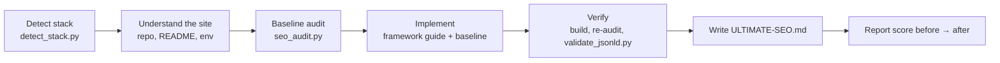

<div align="center">

# Ultimate SEO

**A Claude skill that gives any web project a production-grade SEO setup, then hands you a playbook for everything else.**

Next.js · React · Remix · Astro · Nuxt · SvelteKit · Gatsby · Angular · plain HTML · Hugo · Jekyll · Eleventy · Docusaurus · Django · Rails · Laravel · WordPress · Shopify

[](LICENSE)
[](skills/ultimate-seo/SKILL.md)
[](skills/ultimate-seo/scripts)
[](CONTRIBUTING.md)

</div>

---

Ask Claude *"set up SEO for my site"* and Ultimate SEO will:

1. **Detect your stack**, including framework, version, router, rendering mode, and the SEO pieces you already have.
2. **Audit the baseline** with a bundled crawler that sees your site the way scrapers and AI crawlers do.
3. **Implement the full setup in your framework's own idioms**: metadata, canonicals, Open Graph images, `robots.txt`, sitemaps, JSON-LD, icons, Core Web Vitals fixes, hreflang, and AI-search readiness.
4. **Verify it**: rebuild, re-audit, validate structured data, and report the score before and after.
5. **Write `ULTIMATE-SEO.md`**, a playbook for your specific project. It covers what changed, what to configure, the human-only launch steps, a prioritized 90-day roadmap, a per-page checklist, and a monitoring plan.

No generic tag dumps. No invented business facts. No broken builds.

```text
You:     hey, i've got a nextjs blog i'm launching at https://www.jamiecodes.dev,
         can you sort out all the SEO stuff properly?

Claude:  Detected Next.js 15 (App Router, TypeScript). Baseline audit: 41/100 (F).
         …
         Done. Audit 41 → 97 (A). Added metadataBase + title template, per-post
         generateMetadata with canonicals and OG, app/sitemap.ts (all 3 posts, real
         lastmod), app/robots.ts, dynamic opengraph-image, Person + WebSite +
         BlogPosting JSON-LD, llms.txt. Build passes; JSON-LD validates.
         Top 3 for you: verify the domain in Search Console and submit the sitemap,
         add your real social profiles in lib/site.ts, write the 3 comparison posts in
         the roadmap. Everything is in ULTIMATE-SEO.md.
```

## Contents

- [Why it's different](#why-its-different)
- [Install](#install)
- [Use it](#use-it)
- [What gets implemented](#what-gets-implemented)
- [The `ULTIMATE-SEO.md` playbook](#the-ultimate-seomd-playbook)
- [Bundled tools (usable without Claude)](#bundled-tools-usable-without-claude)
- [Supported stacks](#supported-stacks)
- [How it works](#how-it-works)
- [Repository layout](#repository-layout)
- [Testing](#testing)
- [FAQ](#faq)
- [Contributing](#contributing)

## Why it's different

| | Typical "SEO prompt" or skill | **Ultimate SEO** |
|---|---|---|
| Framework awareness | Pastes `<meta>` tags into whatever file is open | 13 framework guides with idiomatic code, e.g. Next.js Metadata API, Nuxt `useSeoMeta`, SvelteKit endpoints, Astro integrations, Django sitemaps |
| Client-rendered SPAs | Adds tags to `index.html` and calls it done | Detects the empty-shell problem and adds prerendering, since social scrapers and most AI crawlers don't run JavaScript |
| Measurement | None | Bundled auditor (nearly 50 checks, scored A–F) runs before and after, and works on build dirs, dev servers or live URLs |
| Structured data | Copy-paste JSON-LD, often with fake ratings | `@graph`-linked JSON-LD for each page type, checked by a validator that knows Google's current rich-result rules (including the 2023–2025 retirements) |
| Facts | Invents addresses, social profiles and reviews | Never fabricates; unknowns become placeholders listed in the playbook |
| AI search | Not covered | Deliberate AI-crawler policy (GPTBot, ClaudeBot, PerplexityBot…), `llms.txt`, entity clarity, citation-friendly content |
| After the code | Nothing | `ULTIMATE-SEO.md`, a playbook for your project with roadmap, launch checklist and monitoring |
| Quality | Untested | 63 unit tests, a package linter, CI on Python 3.9–3.13, and end-to-end eval cases |

## Install

### Claude Code (plugin, recommended)

```text
/plugin marketplace add Imam-Abubakar/ultimate-seo
/plugin install ultimate-seo@ultimate-seo
```

### Claude Code (manual)

Copy the skill folder into your personal or project skills directory:

```bash
git clone https://github.com/Imam-Abubakar/ultimate-seo.git
```

```bash
cp -R ultimate-seo/skills/ultimate-seo ~/.claude/skills/
```

Use `.claude/skills/` inside a repository instead to share the skill with your team through git.

### Claude.ai and Claude Desktop

Build the upload zip and add it under **Settings → Capabilities → Skills**:

```bash
make package
```

This writes `dist/ultimate-seo.zip`. Code execution must be enabled for the bundled scripts to run.

### Claude API / Agent SDK

Upload `skills/ultimate-seo` as a custom skill through the Skills API, or place it in your Agent SDK project's `.claude/skills/` directory.

## Use it

The skill triggers on its own whenever SEO is involved. You don't need to name it. Some example prompts:

| You say | Claude does |
|---|---|
| "Set up SEO for this project." | Full run: detect → audit → implement → verify → playbook |
| "Why isn't my site showing up on Google?" | Diagnoses indexing blockers (robots, noindex, SPA shell, canonicals) and fixes them |
| "Link previews on Slack and LinkedIn are blank." | Open Graph tags, OG images and server-rendered tags |
| "Audit our SEO but don't change anything." | Audit report and prioritized roadmap in `ULTIMATE-SEO.md`, with no code changes |
| "Add a sitemap." / "Add schema markup for our products." | Does that one thing well and checks the pieces it depends on |
| "Audit https://example.com." | Live crawl, JSON-LD validation, and a roadmap with no repo needed |
| "We're launching in Germany and France next month." | hreflang, localized metadata and sitemaps, and a locale strategy |

## What gets implemented

Every site gets the **baseline**. Extras are added when the project calls for them.

**Baseline**

1. Single source of truth for site config, with the origin URL read from an env var
2. Unique titles and descriptions, an absolute self-referencing canonical, `lang`, viewport and charset
3. Open Graph and Twitter cards, with dynamic OG images where the framework supports them
4. `robots.txt` with an explicit AI-crawler policy, and no accidental `Disallow: /`
5. XML sitemap of canonical, indexable URLs (including dynamic routes) with honest `lastmod`
6. JSON-LD: Organization or Person + WebSite, BreadcrumbList, and the right type for each template
7. Favicon, apple-touch-icon, web manifest and theme-color
8. Indexing hygiene: real 404s, noindex on utility pages, one host and protocol, consistent trailing slashes
9. Rendering: content and links present in server HTML, with prerendering for SPAs
10. Semantic HTML and accessibility: one `h1`, heading order, landmarks, alt text
11. Core Web Vitals quick wins: LCP priority, image dimensions, font loading, script deferral
12. AI-search readiness: `llms.txt`, entity `sameAs`, answer-first structure

**Conditional extras:** international (hreflang), e-commerce (Product, Offer, return and shipping schema, faceted navigation), local business (LocalBusiness, NAP, Google Business Profile), publishers and docs (Article schema, authors, feeds), and large sites (sitemap indexes, crawl budget).

**Things it deliberately won't do**, and will explain why: `meta keywords`, fake reviews or ratings, FAQ markup "for rich results", canonicalizing everything to the home page, blocking CSS/JS, using `robots.txt` to noindex, scaled thin pages, or a `lastmod` that equals build time.

## The `ULTIMATE-SEO.md` playbook

Every run ends with a playbook written for your project, not a generic checklist:

```markdown
# Ultimate SEO playbook — Tidyhive

## Scorecard
| | Before | After |
| Audit score | 31 / F | 93 / A |
| Crawlable without JavaScript | no (SPA shell) | yes (prerendered) |

## Configuration you must fill in
| Social profiles for sameAs | src/site.config.ts | empty |

## Launch checklist (human steps)
- [ ] Google Search Console: add a Domain property for tidyhive.com, submit /sitemap.xml
- [ ] Bing Webmaster Tools: import from Search Console
…

## Roadmap
### Next 30 days
1. Comparison pages ("Tidyhive vs Jobber", "vs ZenMaid"): buyers search these at decision time…
```

See the full template in [`skills/ultimate-seo/assets/ULTIMATE-SEO.template.md`](skills/ultimate-seo/assets/ULTIMATE-SEO.template.md).

## Bundled tools (usable without Claude)

All scripts are standard-library Python 3.9+, so there's nothing to install. Run any of them with `--help` for details.

| Script | What it does |
|---|---|
| [`detect_stack.py`](skills/ultimate-seo/scripts/detect_stack.py) | Identifies 30+ stacks, rendering mode, build output, existing SEO artifacts, SEO/i18n libraries, likely production URL, and monorepo apps |
| [`seo_audit.py`](skills/ultimate-seo/scripts/seo_audit.py) | Audits a build dir, an HTML file, or a URL (with crawling). Runs nearly 50 checks, scores A–F, and emits Markdown or JSON. Has `--fail-under` for CI |
| [`validate_jsonld.py`](skills/ultimate-seo/scripts/validate_jsonld.py) | Lints JSON-LD for syntax, required and recommended properties for each Google rich-result type, absolute URLs, ISO dates, price format, placeholders and retired types |
| [`generate_sitemap.py`](skills/ultimate-seo/scripts/generate_sitemap.py) | Builds `sitemap.xml` from static HTML. Skips noindex, foreign-canonical and error pages, splits into a sitemap index above 50k URLs, and only uses honest `lastmod` |

```bash
python3 skills/ultimate-seo/scripts/seo_audit.py http://localhost:3000 --crawl 50
```

```bash
python3 skills/ultimate-seo/scripts/seo_audit.py dist --base-url https://example.com --fail-under 85
```

Gate SEO regressions in CI:

```yaml
- name: SEO audit
  run: |
    npm run build
    python3 path/to/ultimate-seo/scripts/seo_audit.py dist --base-url https://example.com --fail-under 85
    python3 path/to/ultimate-seo/scripts/validate_jsonld.py dist
```

## Supported stacks

| Stack | Guide | Highlights |
|---|---|---|
| Next.js App Router | [nextjs-app-router.md](skills/ultimate-seo/references/frameworks/nextjs-app-router.md) | Metadata API, `generateMetadata`, `sitemap.ts`/`generateSitemaps`, `opengraph-image`, Next 14–16 differences |
| Next.js Pages Router | [nextjs-pages-router.md](skills/ultimate-seo/references/frameworks/nextjs-pages-router.md) | `next/head`, `getServerSideProps` sitemaps, migration notes |
| React / Vue / Svelte SPAs (Vite, CRA) | [react-spa.md](skills/ultimate-seo/references/frameworks/react-spa.md) | React 19 native head tags, prerendering, why scrapers see nothing |
| Remix / React Router v7 | [react-router-remix.md](skills/ultimate-seo/references/frameworks/react-router-remix.md) | `meta` export, resource routes, `prerender` |
| Astro | [astro.md](skills/ultimate-seo/references/frameworks/astro.md) | `site`, `@astrojs/sitemap`, BaseHead, content collections, OG endpoints |
| Nuxt / Vue | [nuxt-vue.md](skills/ultimate-seo/references/frameworks/nuxt-vue.md) | `useSeoMeta`, `@nuxtjs/seo`, route rules |
| SvelteKit | [sveltekit.md](skills/ultimate-seo/references/frameworks/sveltekit.md) | `<svelte:head>`, `+server.ts` sitemap/robots, prerender |
| Gatsby | [gatsby.md](skills/ultimate-seo/references/frameworks/gatsby.md) | Head API, sitemap and robots plugins |
| Angular | [angular.md](skills/ultimate-seo/references/frameworks/angular.md) | `Title`/`Meta` services, `@angular/ssr`, prerendering, 404 status |
| Plain HTML | [static-html.md](skills/ultimate-seo/references/frameworks/static-html.md) | The ideal `<head>`, and the fallback for anything unknown |
| Hugo, Jekyll, Eleventy, Docusaurus, VitePress, MkDocs | [static-site-generators.md](skills/ultimate-seo/references/frameworks/static-site-generators.md) | Built-in templates and plugins for each generator |
| Django, Flask, Rails, Laravel, Express, Go, ASP.NET, PHP | [server-rendered.md](skills/ultimate-seo/references/frameworks/server-rendered.md) | Template blocks, sitemap frameworks and gems |
| WordPress, Shopify, Webflow, Ghost, headless CMS | [cms-platforms.md](skills/ultimate-seo/references/frameworks/cms-platforms.md) | Yoast and Rank Math, Liquid snippets, CMS SEO fields |

Topic deep-dives: [metadata](skills/ultimate-seo/references/metadata.md) · [technical SEO](skills/ultimate-seo/references/technical-seo.md) · [structured data](skills/ultimate-seo/references/structured-data.md) · [performance](skills/ultimate-seo/references/performance.md) · [AI search](skills/ultimate-seo/references/ai-search.md) · [international](skills/ultimate-seo/references/international.md) · [content strategy](skills/ultimate-seo/references/content-strategy.md) · [local SEO](skills/ultimate-seo/references/local-seo.md) · [e-commerce](skills/ultimate-seo/references/ecommerce.md) · [launch & monitoring](skills/ultimate-seo/references/launch-and-monitoring.md)

## How it works



The skill uses **progressive disclosure**. Claude always sees the short skill description. `SKILL.md`, about 150 lines covering the workflow, loads when SEO comes up. The 23 reference guides (about 6,000 lines) load one at a time, only when they're relevant. A Next.js project never pays for the Shopify guide.

## Repository layout

```text
ultimate-seo/
├── .claude-plugin/            # plugin + marketplace manifests (Claude Code)
├── skills/ultimate-seo/       # ← the skill itself (copy this folder to install)
│   ├── SKILL.md               # workflow, baseline, guardrails, reference map
│   ├── references/            # topic deep-dives
│   │   └── frameworks/        # one idiomatic guide per stack
│   ├── scripts/               # detect_stack, seo_audit, validate_jsonld, generate_sitemap
│   ├── assets/                # ULTIMATE-SEO.md template, robots.txt, llms.txt, JSON-LD templates
│   └── evals/                 # end-to-end eval cases (claude plugin eval format)
├── tests/                     # unit tests + fixture sites/projects
├── tools/validate_skill.py    # package linter (frontmatter, links, manifests, evals)
└── .github/                   # CI, issue and PR templates
```

## Testing

```bash
make test        # package lint + 63 unit tests (no dependencies)
```

```bash
make eval        # end-to-end evals with Claude Code (real model runs, billed)
```

- **Unit tests** cover the scripts against fixture sites (clean, broken, SPA shell, hreflang) and 22 fixture project layouts.
- **Package lint** (`tools/validate_skill.py`) checks the frontmatter spec, that every file `SKILL.md` mentions exists, that every reference is reachable, tables of contents in long references, manifest versions, and eval layout.
- **Evals** (`skills/ultimate-seo/evals/`) are realistic prompts with input projects and graded assertions: a Next.js blog, a Vite SPA launch, a plain-HTML local bakery, and an audit-only Astro site. Run them with `claude plugin eval` from the skill directory.

## FAQ

**Does it guarantee rankings?** No, and nothing honest can. It removes every technical reason not to rank and tells you exactly what content and authority work comes next.

**Will it add dependencies?** Only when one is the community standard for the job (for example `@astrojs/sitemap` or `@nuxtjs/seo`), and it says why. It prefers framework-native features.

**Does it send my code anywhere?** The scripts make no network calls except when you point them at a URL to audit.

**Is the AI-crawler policy opinionated?** The default allows AI search and answer bots, because being cited is a growth channel for most sites. The skill documents the trade-offs and switches to "allow search, block training" when that fits the site, for example publishers.

**How current is the advice?** It reflects search engine guidance as of late 2026, including INP, the FAQ/HowTo and 2025 rich-result retirements, and AI crawlers. Time-sensitive facts are marked "verify against current docs" with source links. PRs that keep it current are very welcome.

## Contributing

Contributions are welcome: new framework guides, better checks, fresher facts, more evals. Read [CONTRIBUTING.md](CONTRIBUTING.md) to get set up. Run `make test` before opening a PR.

## License

[MIT](LICENSE)
